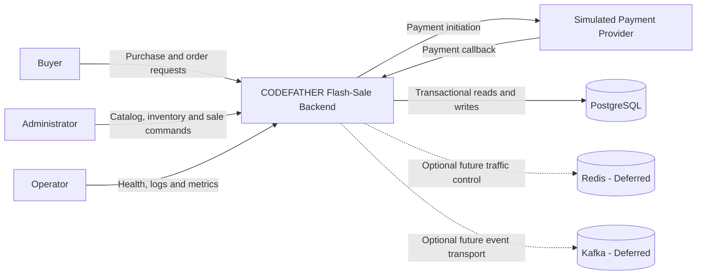
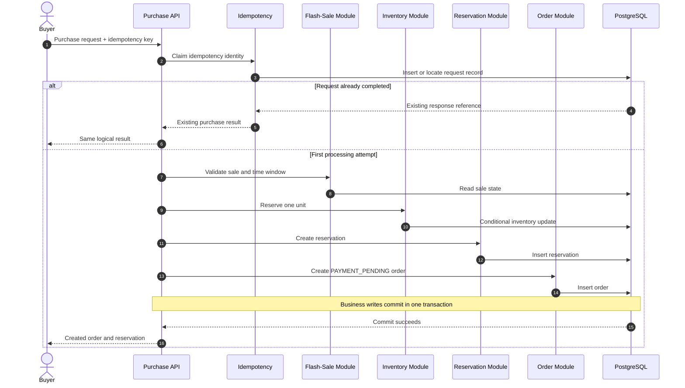
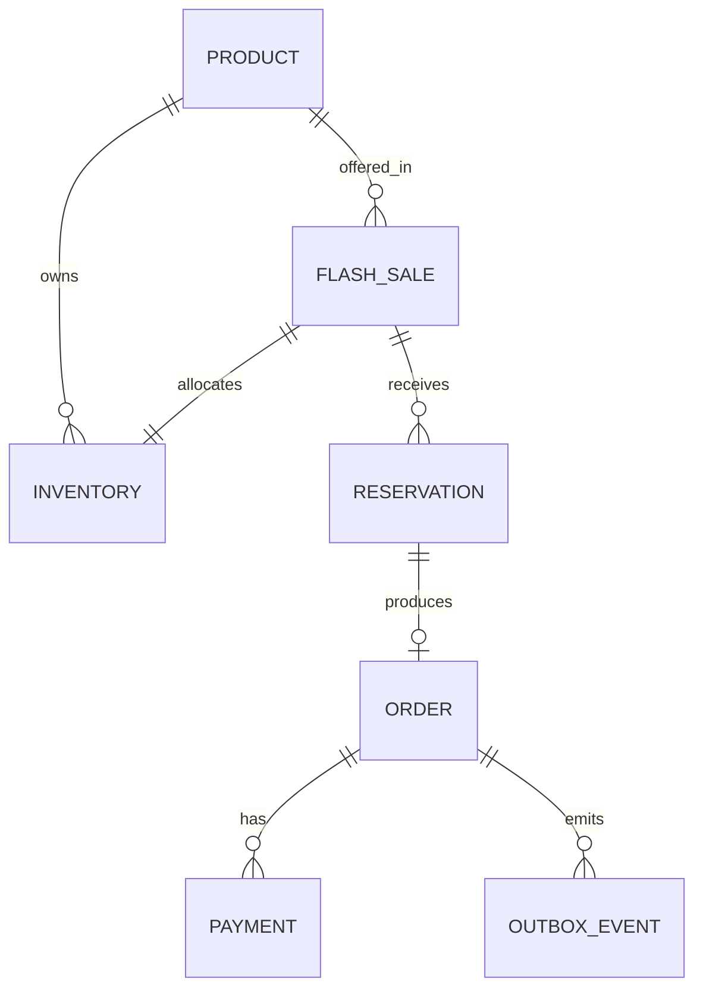

# High-Level Design Version 1

## Status

- Status: Proposed baseline
- Date: November 23, 2026
- Architecture style: Modular monolith
- Primary datastore: PostgreSQL
- Deployment unit: One Spring Boot application

This document describes the initial design direction. It will evolve when
concurrency, load, and failure experiments provide evidence.

## 1. Problem

A flash sale offers a small, fixed quantity of inventory while many users may
attempt to purchase at approximately the same time.

The system must prevent overselling and safely handle:

- concurrent purchase attempts
- repeated client requests
- duplicate or delayed payment callbacks
- reservation expiration
- temporary failures
- retries
- application restarts
- operational investigation

## 2. Goals

The initial system must eventually provide:

1. Product and inventory administration.
2. Flash-sale configuration and time-window enforcement.
3. Inventory reservation.
4. Order creation.
5. Simulated payment processing.
6. Request idempotency.
7. Duplicate callback protection.
8. Reservation expiration and inventory release.
9. Reliable domain-event recording.
10. Auditability, logs, metrics, and test evidence.

## 3. Non-goals

Version 1 does not initially include:

- real payment-gateway integration
- microservices
- Kubernetes
- multi-region deployment
- real customer data
- availability guarantees
- unmeasured production-scale claims

## 4. Actors

### Buyer

Attempts to purchase one unit during an active flash sale and retrieves the
resulting order.

### Administrator

Creates products, establishes inventory, configures flash sales, and inspects
system state.

### Simulated payment provider

Accepts simulated payment requests and sends success or failure callbacks. It
represents an external provider without processing real money.

### Operator or developer

Uses health information, logs, metrics, database records, and test reports to
investigate behavior.

## 5. System context



Redis and Kafka are deferred extension points. They are not part of the
initial correctness path.

## 6. Architecture style

The application is a modular monolith:

- one source repository
- one Spring Boot application
- one deployable process
- one PostgreSQL database
- logical modules separated by business responsibility

Modules communicate through application services and explicit interfaces.
They are not independently deployed network services.

## 7. Logical modules

| Module | Responsibility | Initial data ownership |
|---|---|---|
| `catalog` | Product identity and descriptive information | `products` |
| `inventory` | Available, reserved, and sold quantities | `inventory` |
| `flashsale` | Sale configuration, status, and time window | `flash_sales` |
| `reservation` | Temporary claim over inventory | `reservations` |
| `order` | Purchase record and order lifecycle | `orders` |
| `payment` | Simulated payment attempts and callbacks | `payments` |
| `outbox` | Durable domain-event records | `outbox_events` |
| `notification` | Future notification simulation | notification records if needed |
| `shared` | Errors, identifiers, time, and cross-cutting contracts | none |
| `infrastructure` | Database, web, logging, and runtime adapters | none |

A module may mutate another module's data only through an approved application
interface or documented orchestration boundary.

## 8. Proposed package structure

```text
com.codefather.flashsale
├── catalog
├── inventory
├── flashsale
├── reservation
├── order
├── payment
├── outbox
├── notification
├── shared
└── infrastructure
```

Each business module may later contain `api`, `application`, `domain`, and
`infrastructure` packages when those layers provide real value. Empty layers
will not be created merely for appearance.

## 9. Primary purchase flow

1. Buyer sends a purchase command with an idempotency key.
2. The system claims or retrieves that idempotency identity.
3. The flash-sale window and status are validated.
4. One inventory unit is reserved.
5. A reservation is created.
6. A `PAYMENT_PENDING` order is created.
7. The transaction commits.
8. The buyer receives the new or previously recorded result.



The final inventory concurrency strategy is intentionally not selected yet.
The project will first reproduce a naive race condition and then compare
PostgreSQL concurrency-control alternatives.

## 10. Payment callback flow

The simulated provider sends a callback containing a provider event identity.

The payment module must:

1. Validate callback structure.
2. Detect whether the provider event was already processed.
3. Protect the affected order transition.
4. Apply one legal state transition.
5. Record the payment result.
6. Record an outbox event in the same transaction.
7. Acknowledge an already processed duplicate safely.

A successful callback moves an eligible order to `PAID`.

A failed callback moves an eligible order to `PAYMENT_FAILED` and makes its
reserved inventory eligible for release according to the finalized workflow.

## 11. Provisional order lifecycle

Candidate states:

```text
CREATED
PAYMENT_PENDING
PAID
PAYMENT_FAILED
EXPIRED
CANCELLED
```

Candidate legal transitions:

```text
CREATED -> PAYMENT_PENDING
PAYMENT_PENDING -> PAID
PAYMENT_PENDING -> PAYMENT_FAILED
PAYMENT_PENDING -> EXPIRED
CREATED -> CANCELLED
```

Illegal transitions, including `PAID -> PAYMENT_PENDING`, must be rejected and
tested before the state machine is considered final.

## 12. Consistency boundaries

### Strong consistency required

The following operations require a PostgreSQL transaction:

- claiming an idempotency key and creating its purchase result
- reserving inventory and creating the reservation and order
- applying a payment result and recording its outbox event
- expiring a reservation and releasing inventory
- cancelling an eligible order and releasing inventory

### Eventual consistency acceptable

The following can be processed after the business transaction commits:

- notifications
- analytics
- non-authoritative dashboards
- future external event delivery
- cleanup and archival

PostgreSQL remains authoritative even when eventual mechanisms are added.

## 13. Core invariants

1. Available inventory must never become negative.
2. Successful purchases must never exceed configured inventory.
3. One idempotency identity must not produce multiple purchases.
4. One provider callback identity must not apply its effect twice.
5. A released unit must be returned exactly once.
6. Every successful purchase must be traceable.
7. Every order transition must be legal.
8. An outbox event must correspond to a committed business change.

## 14. Conceptual data relationships



This is conceptual. Columns, indexes, foreign keys, and constraints will be
defined during the domain-and-database milestone.

## 15. Initial API direction

Administrative endpoints:

```text
POST /api/v1/admin/products
POST /api/v1/admin/products/{productId}/inventory
POST /api/v1/admin/flash-sales
GET  /api/v1/admin/flash-sales/{saleId}
```

Buyer endpoints:

```text
POST /api/v1/flash-sales/{saleId}/purchases
GET  /api/v1/orders/{orderId}
```

Simulated payment endpoints:

```text
POST /api/v1/payments
POST /api/v1/webhooks/payments
```

These paths remain provisional until the domain model is finalized.

## 16. Initial deployment view

```text
GitHub Codespace or CI runner
├── Spring Boot application
└── PostgreSQL container
```

The application connects through environment variables. No credential is
stored in Git.

## 17. Expected failures and evidence

| Failure | Expected behavior | Required evidence |
|---|---|---|
| Two buyers compete for the last unit | At most one succeeds | Concurrent integration test |
| Purchase request is retried | Same logical result | Idempotency test |
| Payment callback is duplicated | Business effect occurs once | Callback integration test |
| Reservation expires | Unit is released once | Expiry integration test |
| App stops after DB commit | Durable state remains recoverable | Restart experiment |
| Event publication fails | Outbox event remains pending | Outbox failure test |
| PostgreSQL is unavailable | No false success is returned | Failure report |
| Notification fails | Purchase remains committed | Retry/reconciliation test |

## 18. Security baseline

Version 1 will include:

- external-input validation
- no committed secrets
- separation of administrative endpoints
- safe error responses
- parameterized persistence
- dependency and build checks where practical

Authentication and authorization must exist before administrative APIs are
described as safely exposed outside a controlled environment.

## 19. Observability direction

The application will eventually expose:

- health information
- structured logs
- request or correlation identifiers
- purchase success and failure counters
- inventory rejection counters
- idempotency replay counters
- duplicate callback counters
- reservation-expiry counters
- outbox backlog information

Metrics support operations but do not replace correctness tests.

## 20. Deferred decisions

Evidence is still required before deciding:

- optimistic versus pessimistic inventory control
- final order state machine
- reservation duration
- retry policy
- reservation-expiry scheduling
- outbox relay claiming strategy
- whether Redis is justified
- whether Kafka is justified
- benchmark targets

## 21. Known limitations

- No application implementation exists yet.
- No concurrency strategy has been tested.
- No benchmark has been executed.
- No availability target has been established.
- No external payment system is integrated.
- API and data-model details remain provisional.
